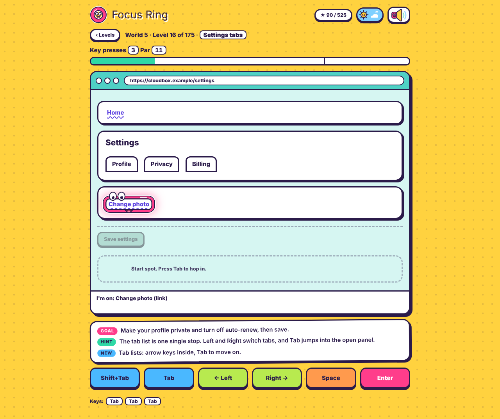

# Focus Ring

A keyboard-only puzzle game about web accessibility. You play the focus ring, the outline that moves when you press Tab, and reach each fake web page's goal in as few key presses as possible.

**[▶ Play it live](https://saima040.github.io/Focus-Ring/)**



## Highlights

- 50 worlds and 175 levels in one HTML file, with no dependencies and no backend
- Every level is proven winnable by a breadth-first solver, which also computes the best possible score (par)
- Automated tests replay all 175 levels in a real browser with real key presses
- Light and dark themes, sound on/off, saved progress
- Works on phones with an on-screen key row
- Teaches real keyboard-accessibility ideas: focus order, focus traps, skip links, menus, popups that steal focus

## How to play

| Key | Action |
|---|---|
| Tab / Shift+Tab | Move to the next / previous element |
| Enter | Press a button or link, open menus and dialogs |
| Space | Tick checkboxes, flip switches, pick radio buttons, pick up and drop items |
| Left / Right (Up / Down) | Move inside a widget (menu bar, radio group, dial, tabs) |
| Esc | Close a popup or dialog, leave a toolbar (unlocked in world 2) |

On touch devices, tap the on-screen keys.

### Scoring

Every key press counts, including useless ones. **Par** is the fewest presses that can win, computed by a solver.

| Presses | Stars |
|---|---|
| par or fewer | 3 |
| up to par + 3 | 2 |
| more | 1 |

One star unlocks the next level. Replaying keeps your best result. Some levels have a clock: the page closes after a set number of presses (always above par).

### Twists

Tab running backwards, a broken key (Space, Enter or Tab), popups that steal focus every nth press, a chat widget that steals focus, a ring that drifts to the next element, focus traps, and clocks.

All levels with par, clock, goal and solutions: [docs/LEVELS.md](docs/LEVELS.md) ([CSV](docs/levels.csv)).

### Saving

No account or backend. Progress is stored in the browser's `localStorage` (`focusring-stars`, `focusring-best`, `focusring-theme`, `focusring-muted`). It stays on that browser and device, and is lost if site data is cleared.

## Technical decisions

- **Pure game engine, separate from the UI.** The same logic runs in the browser and in Node, which made solving and automated testing possible.
- **Solver-computed par.** Scores are the true minimum found by breadth-first search, not hand-tuned numbers.
- **Two-pass clock limits.** Time limits depend on par, and par depends on the limits, so they are computed in two passes and stored.
- **No framework, no build step.** Plain HTML, CSS and JavaScript. It works offline and deploys as a static file.
- **Progress in `localStorage`.** No accounts, no server.
- **Tested in a real browser.** Every level is replayed at par with real key presses and must give 3 stars.

Details: [docs/HOW_IT_WORKS.md](docs/HOW_IT_WORKS.md).

## Run locally

Open `index.html` in a browser, or:

```bash
npm start        # http://localhost:8080  (PORT=3000 npm start to change)
```

## Tests

Requires Node.js 18+.

```bash
npm run verify   # solves all 175 levels, checks pars and clocks (no browser)
npm install      # once, for the browser test
npm run e2e      # replays every level at par with real key presses (Playwright)
npm test         # both
npm run levels   # regenerate docs/LEVELS.md and docs/levels.csv
npm run shots    # regenerate docs/img screenshots
```

If Playwright cannot download Chromium: `CHROMIUM_PATH=/path/to/chrome npm run e2e`.

## Project structure

```
index.html        the whole game (engine, levels, UI)
tools/            verify, e2e, serve, export-levels, screenshots
docs/             LEVELS.md, levels.csv, HOW_IT_WORKS.md, PUBLISHING.md, CHANGELOG.md, img/
LICENSE, package.json, README.md
```

The engine (pure logic, between `// <engine>` and `// </engine>` in `index.html`) is separate from the UI. A breadth-first solver finds each level's par, and the results are stored in `PARS_PRE`.

## Deploy

See [docs/PUBLISHING.md](docs/PUBLISHING.md) for GitHub and GitHub Pages steps.

## Contributing

New levels must be added at the end of the level list so players' saved stars stay correct. Run `npm run verify` before changing levels.

## About this project

Designed and directed by Saima. Built with Claude (Anthropic's AI assistant) through iterative prompting, testing and review.

## License

[MIT](LICENSE)
